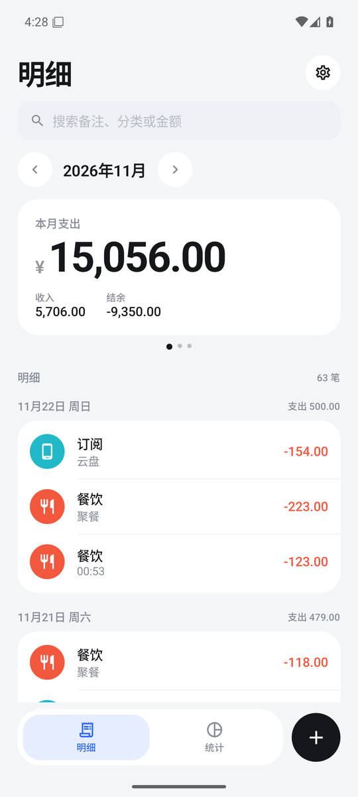
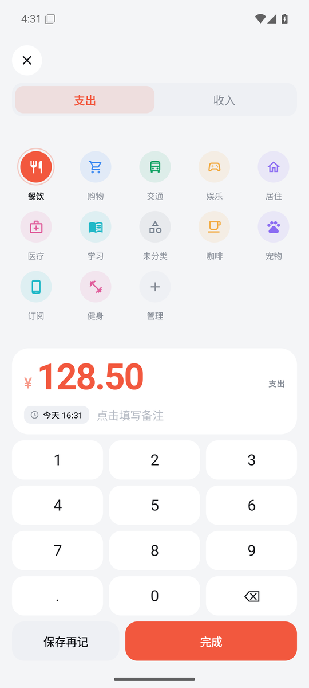
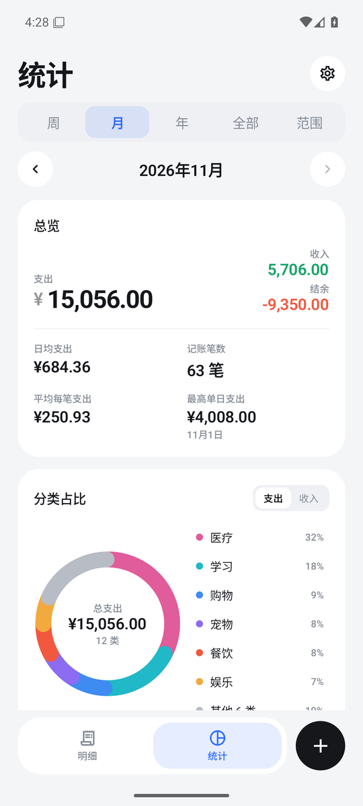
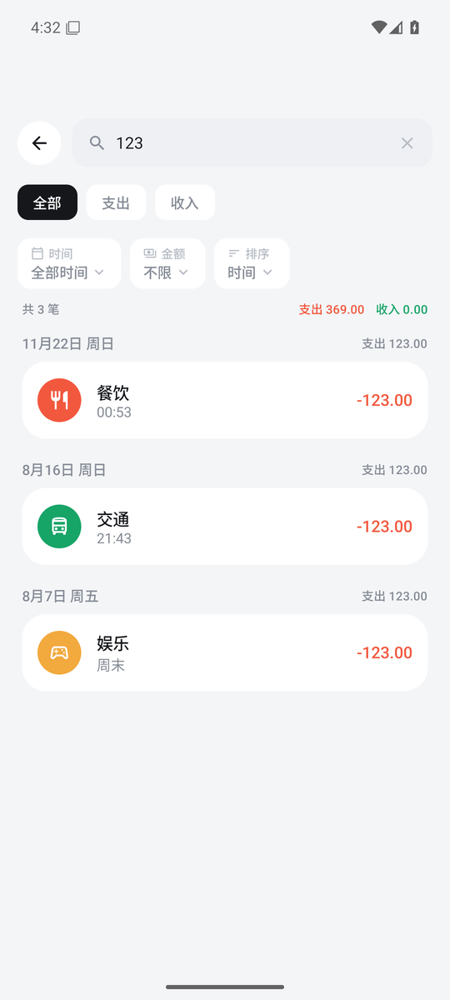

# Fen · 分

一个开源、克制的 Android 记账应用。

没有账号，没有网络请求，账单只保存在本机。

| 明细 | 记账 | 统计 | 搜索 |
| :---: | :---: | :---: | :---: |
|  |  |  |  |

## 功能

- **记账**：支出 / 收入、单层自定义分类、精确到分钟的时间、备注、自定义数字键盘。
- **明细**：按月查看，支出 / 收入 / 结余汇总卡，按天分组与日小计；点按编辑，长按删除。
- **搜索**：按关键词、类型、时间、金额筛选，支持排序与结果汇总。
- **统计**：周 / 月 / 年 / 全部 / 自定义范围；分类占比、分类排行、收支趋势、累计结余、收支对比、星期分布、账单汇总。看板内容与顺序可调整。
- **分类**：自定义名称、图标与颜色；已有流水的分类不可删除。
- **导入**：自动识别微信、支付宝、京东、美团、iCost、鲨鱼记账、一木记账、木木记账、钱迹、团团记账等账单，也支持通用 CSV / Excel；导入前可预览与调整分类，导入记录按批次管理。
- **导出**：账单 CSV 与导入模板。
- **备份**：完整 JSON 备份与恢复。
- **外观**：跟随系统 / 浅色 / 深色。

## 隐私

应用未申请网络权限，不会上传任何数据。账单与设置默认只写入应用私有目录；导出和备份文件由你自行选择保存位置。

## 构建

需要 JDK 17 或更高版本，以及 Android SDK（Platform 37）。

```bash
git clone https://github.com/Aj002Th/fen.git
cd fen

# macOS / Linux
./gradlew :app:assembleDebug

# Windows
gradlew.bat :app:assembleDebug
```

产物位于 `app/build/outputs/apk/debug/app-debug.apk`。目前尚未上架应用商店，构建后直接安装即可。

运行单元测试：

```bash
./gradlew :app:testDebugUnitTest
```

## 技术栈

Kotlin · Jetpack Compose · Material 3 · SQLite。minSdk 26，targetSdk 37。

## License

[Apache License 2.0](LICENSE)
